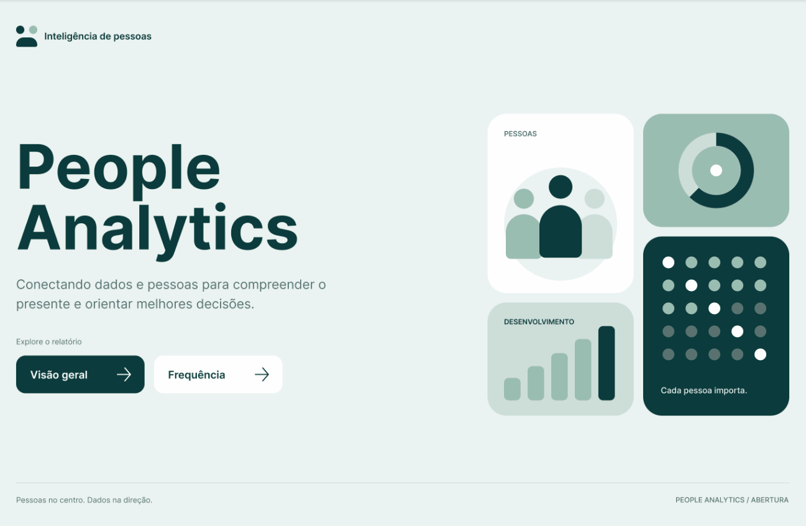

# A empresa está conseguindo reter as pessoas que contrata?

Análise em Power BI de contratações, demissões, turnover, absenteísmo e horas extras.

🔗 [Abrir o relatório no Power BI](URL_DO_RELATORIO) · [Medidas DAX](caminho/para/medidas-dax) 

---

## Pergunta de negócio

Onde a empresa contrata e perde pessoas, quanto disso vem de más contratações e quanto custam as horas extras e o absenteísmo?

## Resposta resumida

Entraram mais pessoas do que saíram (**860 contratações contra 611 demissões**), mas desde 2018 as demissões igualam ou superam as contratações. O turnover é de **15,4%** e **12,09%** das contratações são más contratações. As horas extras custam cerca de **8 vezes** o absenteísmo (**R$ 269 mil contra R$ 34 mil**).

## Principais achados

1. **A retenção piorou desde 2018.** O pico de contratações foi em 2013 (110), e em 2016 e 2017 entraram 136 pessoas e saíram 46. Em 2018, 2019 e 2020 as demissões foram iguais ou maiores que as contratações (saldo de −20).
2. **As contratações são concentradas.** 46,7% são de pessoas de 35 a 44 anos, e os cinco cargos principais (Operador, Gestor, Aprendiz, Assistente e Auxiliar) somam 47,6%. 67,21% são homens.
3. **Horas extras são o maior custo de frequência.** R$ 269.110 (5,65%) contra R$ 34.001 (0,71%) de absenteísmo. Em maio de 2020 as horas extras caíram 60% desde março (7,93% para 3,17%), e o absenteísmo chegou a 0,91% em julho, o maior do período.
4. **O absenteísmo varia entre grupos.** É maior até 34 anos (1,39% e 1,19%) do que acima de 55 (0,43%), e maior no grupo indígena (3,07%) do que no branco (0,63%).

## Hipóteses a validar (não comprovadas pelos dados)

- A queda de maio de 2020 pode estar ligada ao início da pandemia.
- As saídas de 2018 a 2020 podem incluir quem entrou em 2016 e 2017.
- Os valores altos em grupos pequenos podem refletir poucas pessoas, não um padrão.

## Páginas do relatório

1. **Capa:** navegação entre as páginas.
2. **Visão geral:** KPIs, turnover, faixa etária, gênero, cargo e evolução anual.
3. **Frequência:** absenteísmo e horas extras por mês e por etnia, faixa etária e gênero.

## Modelo de dados

Modelo em estrela: `fContrato` (fato), `dFuncionario` e `dCalendario` (dimensões) e uma tabela de medidas.

## Ferramentas

Power BI (DAX), SQL *(remova se não usou)*, Figma (layout).

## Sobre o projeto

Parti de uma base usada em curso **[PREENCHER: nome do curso]**. O layout, as análises e a narrativa desta versão são de autoria própria *(ajuste conforme o que você fez)*.

## Autora

**[Seu nome]** · [LinkedIn](URL_DO_LINKEDIN)
